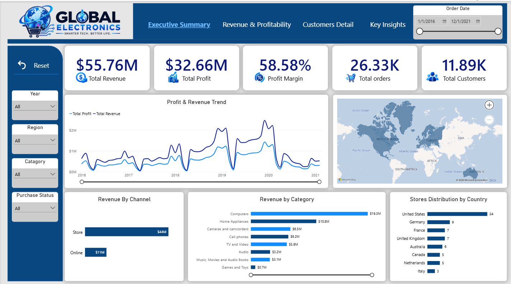
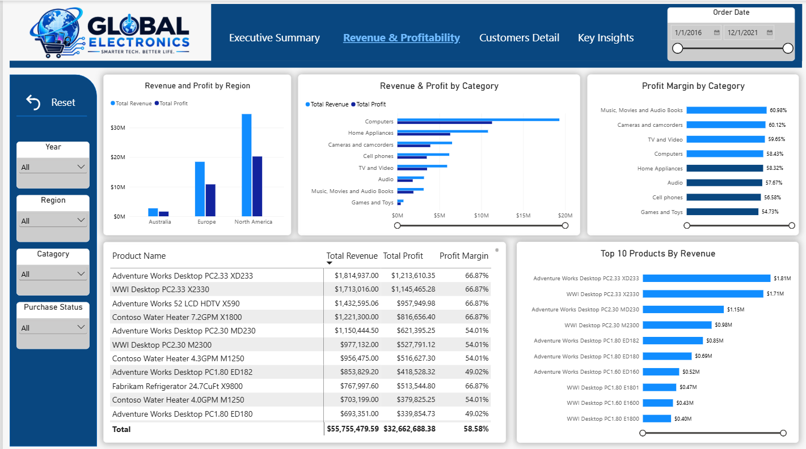
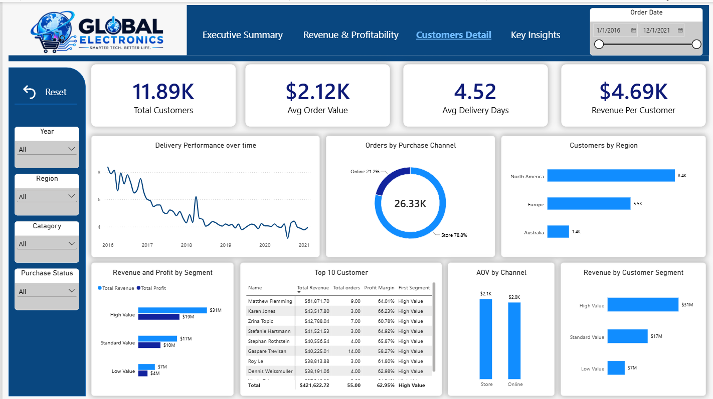
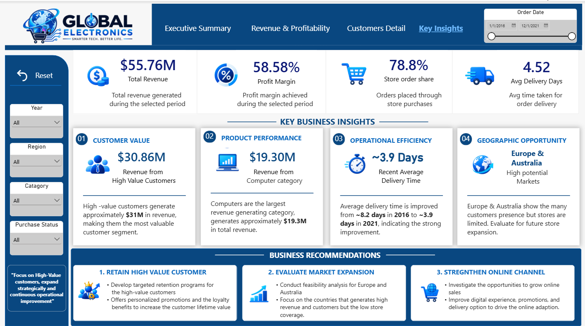
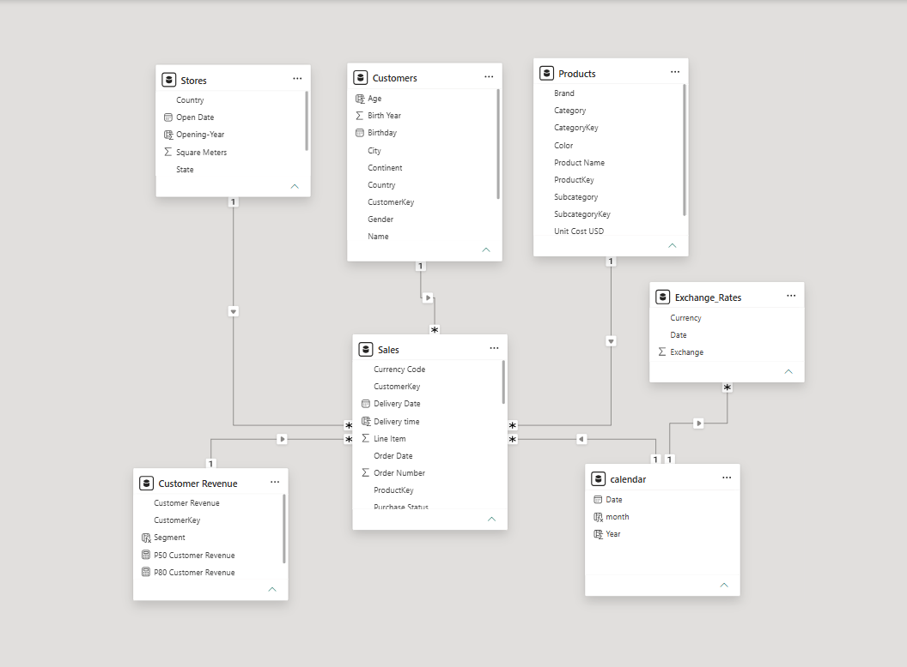

# Global Electronics Retailer — Sales & Profitability Analysis

### Power BI | DAX | Power Query | Data Modeling | Business Intelligence

An end-to-end **Power BI sales and profitability analysis** of the Global Electronics Retailer dataset from **2016–2021**.

This project transforms transactional data into an interactive business intelligence solution to analyze revenue, profitability, customers, products, sales channels, regional performance, seasonal trends, and delivery operations.

---

## Business Questions

This project addresses the four core business questions provided by **Maven Analytics**:

1. **What types of products does the company sell, and where are customers located?**
2. **Are there any seasonal patterns or trends for order volume or revenue?**
3. **How long is the average delivery time in days? Has that changed over time?**
4. **Is there a difference in average order value (AOV) for online vs. in-store sales?**

---

## Executive Summary

| KPI | Result |
|---|---:|
| **Total Revenue** | ~$55.76M |
| **Total Profit** | ~$32.66M |
| **Profit Margin** | ~58.58% |
| **Total Orders** | ~26.33K |
| **Total Customers** | ~11.89K |
| **Average Delivery Days** | ~4.52 |
| **Online AOV** | $2,043.79 |
| **Store AOV** | $2,137.82 |

### Key Findings

- **Computers** is the strongest revenue-generating category.
- **North America** is the strongest region by customer base and revenue contribution.
- Sales generally weaken during **Q2** and strengthen through **Q3–Q4 and Q1**.
- Average delivery time improved from approximately **8.2 days in 2016 to 3.9 days in 2021**.
- **Store AOV is $94.03 higher than Online AOV**, approximately **4.6% higher**.
- High-value customers generate approximately **$31M in revenue**.
- Store orders account for approximately **78.9%** of total orders.

---

## Dashboard

### Executive Summary



Provides a high-level overview of revenue, profit, profitability, customers, orders, and overall business performance.

### Revenue & Profitability



Analyzes revenue and profitability across product categories, countries, and other business dimensions.

### Customer Detail



Analyzes customer value, customer segmentation, revenue per customer, sales channels, and Online vs. Store AOV.

### Key Insights & Recommendations



Summarizes the major findings and translates the analysis into actionable business recommendations.

---

## Data Model



The Power BI data model connects the core business entities required for sales, product, customer, store, regional, and time-based analysis.

The model supports:

- Product analysis
- Customer analysis
- Regional analysis
- Sales channel analysis
- Time-series analysis
- Delivery analysis
- Revenue and profitability analysis

---

# Business Analysis

## 1. Product & Customer Geography

### Finding

The **Computers category** generates the highest revenue among the major product categories analyzed.

**North America** represents the strongest customer base and contributes significant revenue and profit.

### Business Impact

Revenue should not be the only factor used when making product investment decisions.

Management should also consider:

- Absolute profit
- Profit margin
- Customer demand
- Growth potential

Regional opportunities should be evaluated using customer demand, revenue per customer, profitability, operating costs, and expected ROI.

---

## 2. Seasonal Sales Trends

### Finding

The analysis identifies recurring changes in revenue and order volume throughout the year.

Sales generally:

- Decline during **Q2**
- Recover during **Q3**
- Strengthen during **Q4 and Q1**

### Business Impact

Seasonal patterns can support:

- Inventory planning
- Marketing campaign timing
- Staffing decisions
- Promotional planning
- Sales forecasting

The business can prepare inventory and marketing activities ahead of historically stronger periods.

---

## 3. Delivery Performance

### Finding

Average delivery time is approximately **4.52 days**.

Delivery performance improved from approximately:

**8.2 days in 2016 → 3.9 days in 2021**

### Business Impact

The improvement indicates stronger delivery performance over time.

Management should identify the operational drivers behind the improvement and replicate successful practices in weaker-performing regions.

### Analytical Consideration

Because an order can contain multiple line items, delivery performance was evaluated at the **order level** rather than treating every line item as an independent order.

---

## 4. Online vs. Store AOV

### Finding

| Channel | Average Order Value |
|---|---:|
| **Online** | **$2,043.79** |
| **Store** | **$2,137.82** |

Store AOV is approximately **$94.03 higher per order**, or **4.6% higher**, than Online AOV.

### Business Impact

Customers spend more per order in physical stores.

This creates an opportunity to investigate whether factors such as:

- Product mix
- Bundling
- Promotions
- Cross-selling
- Customer purchasing behavior

are contributing to the higher Store AOV.

Successful Store strategies could potentially be tested in the Online channel.

---

# Additional Business Insights

## High-Value Customers

High-value customers generate approximately **$31M in revenue**, making this segment strategically important.

A significant amount of revenue is concentrated among high-value customers, making customer retention an important area for further analysis.

Useful metrics for future analysis include:

- Customer retention rate
- Churn rate
- Customer lifetime value
- Customer acquisition cost
- Retention cost
- Revenue concentration

---

## Store vs. Online

Approximately:

- **78.9% of orders are Store orders**
- **21.1% of orders are Online orders**

Store is therefore the dominant channel by order volume.

However, channel investment should not be based on order share alone.

Management should compare:

- Revenue
- Profit
- Profit margin
- AOV
- Customer acquisition cost
- Customer lifetime value

---

## Product Performance

The Computers category generates the highest revenue.

However, the highest-revenue category does not automatically represent the highest profitability.

Product decisions should therefore consider both **revenue and profit performance**.

---

# Business Recommendations

## 1. Protect High-Value Revenue

Prioritize retention analysis for high-value customers and compare the cost of retaining existing customers with the cost of acquiring new customers.

## 2. Increase Online Customer Value

Online AOV is currently lower than Store AOV.

Investigate the factors behind higher Store spending and test successful Store strategies in the Online channel, such as:

- Product bundles
- Cross-selling
- Promotions
- Personalized recommendations

## 3. Optimize Product Investment

The Computers category generates the highest revenue, but product investment should also consider:

- Profit
- Profit margin
- Customer demand
- Growth
- Product economics

## 4. Maintain Delivery Improvements

Delivery performance improved substantially between 2016 and 2021.

Identify the operational drivers behind this improvement and replicate them across weaker-performing regions.

## 5. Evaluate European Expansion

Europe may represent a potential expansion opportunity, but the current analysis does not prove that opening new stores will be profitable.

Before opening new stores, management should evaluate:

- Expected revenue
- Expected profit
- Customer demand
- Revenue per customer
- Operating costs
- Competition
- Store coverage
- Return on investment

---

# DAX Highlights

Key DAX measures were developed to support the business analysis and KPI reporting.

- **Revenue:** Calculates sales revenue using product quantity and the related unit price.
- **Total Profit:** Measures the difference between total revenue and total cost.
- **Profit Margin:** Measures profitability as a percentage of total revenue.
- **Average Order Value:** Calculates average revenue generated per distinct order.
- **Revenue per Customer:** Measures the average revenue generated per customer.
- **Average Delivery Days:** Calculates delivery performance at the order level to avoid giving repeated line items excessive weight.
- **Customer Segmentation:** Classifies customers based on their revenue contribution using percentile-based thresholds.

These measures support the dashboard KPIs, customer analysis, profitability analysis, and operational insights.

---

# Analytical Approach

The project follows a business-focused analytical framework:

### WHAT → WHY → SO WHAT → NOW WHAT

| Stage | Question |
|---|---|
| **What?** | What is happening in the data? |
| **Why?** | What could be driving the result? |
| **So What?** | What is the business impact? |
| **Now What?** | What action should management consider? |

This approach moves the analysis beyond descriptive reporting and toward actionable business recommendations.

---

# Technical Workflow

```text
Raw Transactional Data
        ↓
Data Cleaning & Transformation
        ↓
Data Modeling
        ↓
DAX Measures
        ↓
Interactive Power BI Dashboard
        ↓
Business Analysis
        ↓
Insights & Recommendations
```
---

# Skills Demonstrated

### Data & Business Intelligence

- Power BI
- DAX
- Power Query
- Data Modeling
- KPI Development

### Data Analysis

- Sales Analysis
- Revenue & Profitability Analysis
- Customer Segmentation
- Product Analysis
- Regional Analysis
- Time-Series Analysis
- Channel Analysis
- Delivery Performance Analysis

### Business & Communication

- Business Question Framing
- Problem Solving
- Insight Generation
- Data Storytelling
- Business Recommendations
- Decision Support

---

# Project Outcome

This project demonstrates the ability to transform transactional data into meaningful business insights and actionable recommendations.

**Data → Analysis → Insight → Action**

The analysis identifies revenue drivers, customer value, channel differences, seasonal patterns, product performance, and operational trends.

---

# Contact

**GitHub:** [Muhammad Ahsan](https://github.com/ahsantaga)  
**Email:** [ahsantaga01@gmail.com](mailto:ahsantaga01@gmail.com)  
**LinkedIn:** [Muhammad Ahsan](https://www.linkedin.com/in/muhammad-ahsan-ch-99b806426/)
